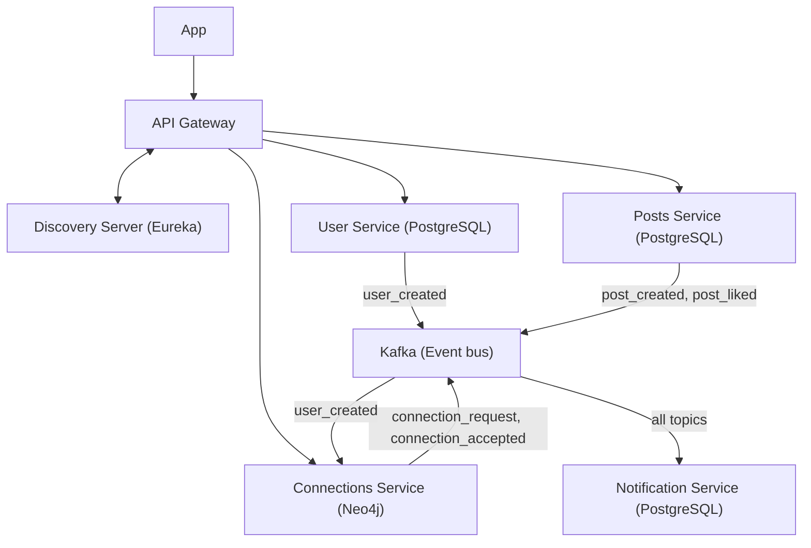

# LinkedIn Microservices

A social networking backend inspired by LinkedIn, built to explore microservices architecture, service discovery, event-driven communication, and polyglot persistence. The system supports core social features — user accounts, posts, connections, and notifications — split across independently deployable Spring Boot services.

## Architecture

The application follows a microservices architecture with a central API Gateway routing requests to backend services. Services communicate synchronously via OpenFeign for direct calls and asynchronously via Kafka for event-driven workflows, decoupling services and avoiding cascading failures.



## Services

| Service | Responsibility | Database |
|---|---|---|
| **API Gateway** | Single entry point; routes and secures all incoming client requests | - |
| **Discovery Server** | Service registration and discovery via Netflix Eureka | - |
| **User Service** | User accounts, authentication, profile management; publishes `user_created` events | PostgreSQL |
| **Posts Service** | Post creation, likes; publishes `post_created` and `post_liked` events | PostgreSQL |
| **Connections Service** | Manages user connections and relationship graph; consumes `user_created` to create graph nodes, publishes `connection_request` and `connection_accepted` events | Neo4j |
| **Notification Service** | Consumes events from all producing services to generate user notifications | PostgreSQL |

## Key Design Decisions

- **Service Discovery & Routing** — Netflix Eureka handles dynamic service registration and discovery, while Spring Cloud Gateway serves as the single entry point for routing and cross-cutting concerns.
- **Hybrid Communication Model** — OpenFeign is used for synchronous, request-response calls between services (e.g., validation checks), while Kafka handles asynchronous, event-driven flows. User, Posts, and Connections services each publish domain events (`user_created`; `post_created`, `post_liked`; `connection_request`, `connection_accepted`). The Connections Service also consumes `user_created` to create corresponding nodes in its graph, keeping the Neo4j graph in sync without a direct service-to-service call, and the Notification Service consumes all topics to generate user-facing notifications — keeping services decoupled and resilient to individual failures.
- **Polyglot Persistence** — Each service owns its own database (database-per-service pattern). Most services use PostgreSQL for relational data, but the Connections Service uses **Neo4j**, modeling users and relationships as a native graph. This replaces expensive multi-hop relational joins with constant-depth graph traversal for queries like 2nd- and 3rd-degree connections.
- **Containerization** — All services are containerized with Docker for consistent local development and deployment.

## Tech Stack

- **Language & Framework:** Java, Spring Boot
- **Service Discovery / Gateway:** Netflix Eureka, Spring Cloud Gateway
- **Inter-Service Communication:** OpenFeign (sync), Apache Kafka (async)
- **Persistence:** Spring Data JPA, PostgreSQL, Neo4j
- **Containerization:** Docker

## Getting Started

### Prerequisites
- Java 17+
- Maven
- Docker & Docker Compose
- PostgreSQL and Neo4j (or run via Docker)

### Running Locally

1. Clone the repository
   ```bash
   git clone https://github.com/sahilshirodkar1630/LinkedIn-Microservices.git
   cd LinkedIn-Microservices
   ```

2. Start the Discovery Server first, so other services can register with it
   ```bash
   cd DiscoverServer
   mvn spring-boot:run
   ```

3. Start the remaining services (each in its own terminal)
   ```bash
   cd userService && mvn spring-boot:run
   cd postsService && mvn spring-boot:run
   cd ConnectionsService && mvn spring-boot:run
   cd NotificationService && mvn spring-boot:run
   cd APIGateway && mvn spring-boot:run
   ```

4. Access the system through the API Gateway (default: `http://localhost:8080`)

> Note: This project currently runs locally via Docker. Kubernetes deployment is planned as a future enhancement.

## Roadmap

- [ ] Kubernetes deployment (Deployments for stateless services, StatefulSets for databases/Kafka)
- [ ] Distributed tracing with Zipkin
- [ ] Centralized logging with the ELK stack
- [ ] CI/CD pipeline via Jenkins
- [ ] Automated unit and integration tests

## Author

**Sahil Shirodkar**
[GitHub](https://github.com/sahilshirodkar1630) · [LinkedIn](https://linkedin.com)
