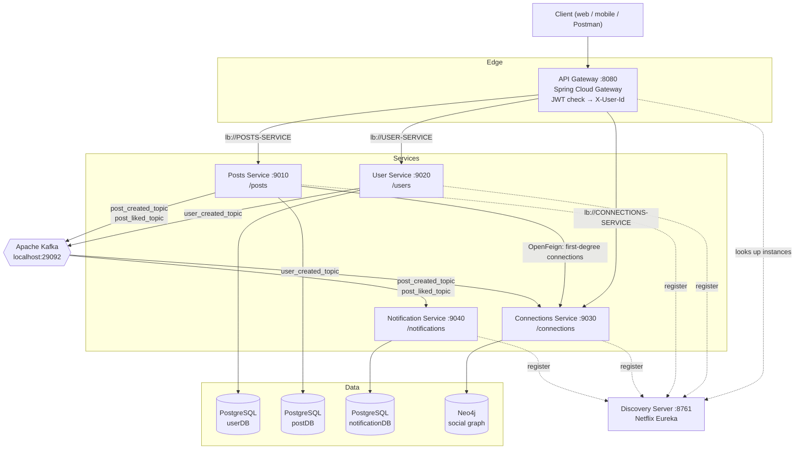
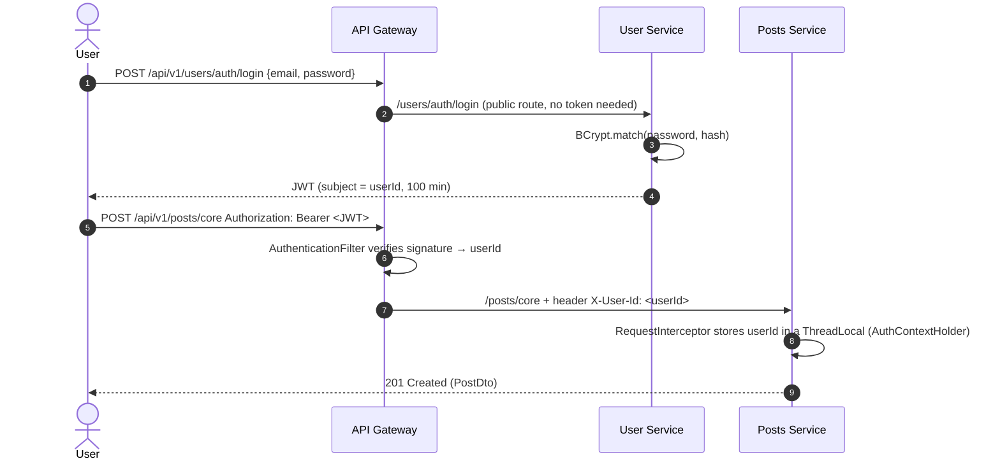
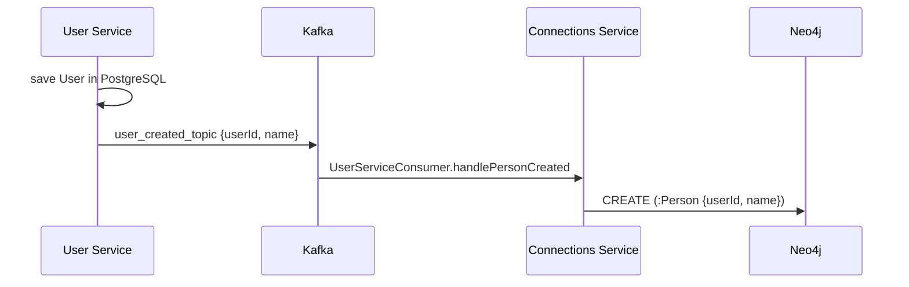
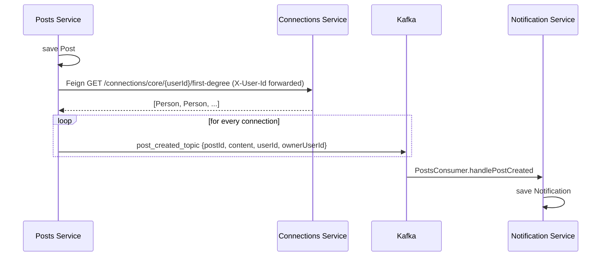

# LinkedIn Microservices

A social-networking backend inspired by LinkedIn, built as **six independently deployable Spring Boot services**.
It covers user accounts, posts and likes, a connection graph and notifications, and demonstrates the core
microservice building blocks: **service discovery (Eureka)**, an **API gateway with JWT authentication**,
**synchronous calls with OpenFeign**, **asynchronous events with Apache Kafka**, and **polyglot persistence**
(PostgreSQL for relational data, **Neo4j** for the social graph).

> For a file-by-file explanation of every service, read **[docs/CODE_WALKTHROUGH.md](docs/CODE_WALKTHROUGH.md)**.

---

## Table of contents

1. [What it does](#what-it-does)
2. [Architecture](#architecture)
3. [Services at a glance](#services-at-a-glance)
4. [How the pieces talk to each other](#how-the-pieces-talk-to-each-other)
5. [Kafka topics and events](#kafka-topics-and-events)
6. [Key design decisions](#key-design-decisions)
7. [API reference (through the gateway)](#api-reference-through-the-gateway)
8. [Tech stack](#tech-stack)
9. [Running locally](#running-locally)
10. [Project structure](#project-structure)
11. [Known limitations and roadmap](#known-limitations-and-roadmap)

---

## What it does

| Feature | Where it lives |
|---|---|
| Sign up and log in; passwords hashed with BCrypt; a signed JWT is returned on login | **User Service** |
| Every request to protected services is authenticated once at the edge, and the caller's id is forwarded as `X-User-Id` | **API Gateway** |
| Create posts, read a post, list a user's posts, like and unlike posts | **Posts Service** |
| Send, accept and reject connection requests; list first-degree connections | **Connections Service** (Neo4j graph) |
| When a user signs up, a matching node is created in the graph — automatically, through Kafka | User → Kafka → Connections |
| When someone posts or likes a post, notifications are generated and stored | Posts → Kafka → **Notification Service** |
| All services find each other by name instead of hard-coded addresses | **Discovery Server** (Eureka) |

---

## Architecture



---

## Services at a glance

| Service | Port | Context path | Database | Responsibilities | Produces | Consumes |
|---|---|---|---|---|---|---|
| **Discovery Server** | 8761 | – | – | Eureka registry; every other service registers here | – | – |
| **API Gateway** | 8080 | – | – | Single entry point, routing with client-side load balancing, JWT validation, adds `X-User-Id` | – | – |
| **User Service** | 9020 | `/users` | PostgreSQL `userDB` | Sign-up, login, BCrypt hashing, JWT issuing | `user_created_topic` | – |
| **Posts Service** | 9010 | `/posts` | PostgreSQL `postDB` | Posts and likes; asks Connections for a user's connections | `post_created_topic`, `post_liked_topic` | – |
| **Connections Service** | 9030 | `/connections` | Neo4j | `Person` nodes, `REQUESTED_TO` and `CONNECTED_TO` relationships | – | `user_created_topic` |
| **Notification Service** | 9040 | `/notifications` | PostgreSQL `notificationDB` | Turns events into stored notifications | – | `post_created_topic`, `post_liked_topic` |

Each service **owns its database** — no service reads another service's tables (database-per-service pattern).

---

## How the pieces talk to each other

### 1. Authentication at the edge



Only the gateway and the user service know the JWT secret. Downstream services never parse tokens — they trust the
`X-User-Id` header that the gateway adds. (This assumes the services are reachable only through the gateway, e.g.
on a private network.)

### 2. Sign-up creates a graph node via Kafka



The user service does not call the connections service directly — if Connections is down, sign-up still succeeds and
the node is created once it comes back and reads the topic.

### 3. Creating a post fans out notifications



### 4. Liking a post

`PostLikeService.likePost` saves a `PostLike` (rejecting duplicate likes) and publishes
`post_liked_topic {postId, ownerUserId, likedByUserId}`; the notification service stores
"User X has liked this post Y" for the post's owner.

---

## Kafka topics and events

| Topic | Created by | Producer | Consumer (group id) | Payload |
|---|---|---|---|---|
| `user_created_topic` | User Service (`KafkaConfig`) — 3 partitions | `AuthService.signUp` | Connections Service (`connections-service`) | `UserCreatedEvent { userId, name }` |
| `post_created_topic` | Posts Service — 3 partitions | `PostService.createPost` (one event per connection) | Notification Service (`notification-service`) | `PostCreated { postId, content, userId, ownerUserId }` |
| `post_liked_topic` | Posts Service (also declared in User Service) — 3 partitions | `PostLikeService.likePost` | Notification Service (`notification-service`) | `PostLiked { postId, ownerUserId, likedByUserId }` |

Serialization: keys use `LongSerializer`, values are JSON (`JsonSerializer` / `JsonDeserializer`). Consumers trust
the packages `com.sahil.linkedInProject.*`, which is why each consumer keeps a copy of the event class in the
*producer's* package name (e.g. `com.sahil.linkedInProject.postsService.event.PostLiked` inside the Notification
Service) — the JSON type header then resolves to a local class.

---

## Key design decisions

- **API Gateway as the single entry point** — routing, load balancing (`lb://SERVICE-NAME` resolves through
  Eureka) and authentication live in one place, so services stay focused on business logic.
- **Authenticate once, propagate identity** — the gateway turns a JWT into an `X-User-Id` header. Each service
  keeps the id in a request-scoped `ThreadLocal` (`AuthContextHolder`), and a Feign interceptor copies it onto
  outgoing service-to-service calls.
- **Sync where you need an answer, async where you don't** — Posts *needs* the list of connections right now, so it
  uses OpenFeign. Creating graph nodes and notifications can happen a moment later, so they go through Kafka. This
  keeps a slow or failed notification service from breaking posting.
- **Polyglot persistence** — social connections are a graph. In Neo4j, "my connections" is a one-hop
  relationship match, and second/third-degree queries stay simple pattern matches instead of chains of SQL
  self-joins.
- **Database per service** — services can change their schema, scale and be deployed independently.

---

## API reference (through the gateway)

Base URL: `http://localhost:8080`. The gateway strips the first two segments (`StripPrefix=2`), so
`/api/v1/posts/core` reaches the posts service as `/posts/core` (its context path is `/posts`).

Protected routes need `Authorization: Bearer <token>`.

### User Service — `/api/v1/users` (public)

| Method | Path | Body | Response |
|---|---|---|---|
| POST | `/api/v1/users/auth/signup` | `{ "name", "email", "password" }` | `201` `{ "id", "name", "email" }` |
| POST | `/api/v1/users/auth/login` | `{ "email", "password" }` | `200` — the JWT as a plain string |

### Posts Service — `/api/v1/posts` (JWT required)

| Method | Path | Body | Response |
|---|---|---|---|
| POST | `/api/v1/posts/core` | `{ "content": "Hello LinkedIn!" }` | `201` `{ "id", "content", "userId", "createdAt" }` |
| GET | `/api/v1/posts/core/{postId}` | – | `200` `PostDto` |
| GET | `/api/v1/posts/core/users/{userId}/allPosts` | – | `200` `PostDto[]` |
| POST | `/api/v1/posts/likes/{postId}` | – | `204` (400 if already liked, 404 if no such post) |
| DELETE | `/api/v1/posts/likes/{postId}` | – | `204` (400 if not liked yet) |

### Connections Service — `/api/v1/connections` (JWT required)

| Method | Path | Meaning | Response |
|---|---|---|---|
| GET | `/api/v1/connections/core/{userId}/first-degree` | Direct connections of a user | `200` `Person[]` (`{ id, userId, name }`) |
| POST | `/api/v1/connections/core/request/{userId}` | Send a request **to** `userId` | `204` |
| POST | `/api/v1/connections/core/accept/{userId}` | Accept the request **from** `userId` | `204` |
| POST | `/api/v1/connections/core/reject/{userId}` | Reject the request **from** `userId` | `204` |

The caller is always taken from the token — you cannot send or accept requests on someone else's behalf.

### Errors

Services return a common shape:

```json
{ "timeStamp": "2026-08-26T10:15:30", "error": "Post not found with ID: 42", "statusCode": "NOT_FOUND" }
```

`ResourceNotFoundException` → 404, `BadRequestException` → 400, other `RuntimeException`s → 500 (User, Connections
and Notification services). The gateway itself returns a bare `401` for a missing or invalid token.

### Quick try with curl

```bash
# sign up two users
curl -X POST localhost:8080/api/v1/users/auth/signup -H 'Content-Type: application/json' \
     -d '{"name":"Asha","email":"asha@example.com","password":"pass123"}'
curl -X POST localhost:8080/api/v1/users/auth/signup -H 'Content-Type: application/json' \
     -d '{"name":"Ravi","email":"ravi@example.com","password":"pass123"}'

ASHA=$(curl -s -X POST localhost:8080/api/v1/users/auth/login -H 'Content-Type: application/json' \
       -d '{"email":"asha@example.com","password":"pass123"}')
RAVI=$(curl -s -X POST localhost:8080/api/v1/users/auth/login -H 'Content-Type: application/json' \
       -d '{"email":"ravi@example.com","password":"pass123"}')

# Asha (id 1) sends a request to Ravi (id 2); Ravi accepts
curl -X POST localhost:8080/api/v1/connections/core/request/2 -H "Authorization: Bearer $ASHA"
curl -X POST localhost:8080/api/v1/connections/core/accept/1  -H "Authorization: Bearer $RAVI"
curl localhost:8080/api/v1/connections/core/1/first-degree    -H "Authorization: Bearer $ASHA"

# post and like
curl -X POST localhost:8080/api/v1/posts/core -H "Authorization: Bearer $ASHA" \
     -H 'Content-Type: application/json' -d '{"content":"My first post"}'
curl -X POST localhost:8080/api/v1/posts/likes/1 -H "Authorization: Bearer $RAVI"
```

---

## Tech stack

| Concern | Technology |
|---|---|
| Language / framework | Java 21, Spring Boot 3.3 (Notification Service: Spring Boot 4.1) |
| Microservice infrastructure | Spring Cloud 2023.0 — Gateway (reactive), Netflix Eureka server/client, OpenFeign |
| Messaging | Apache Kafka with Spring for Apache Kafka (JSON values, `Long` keys) |
| Databases | PostgreSQL (Spring Data JPA / Hibernate), Neo4j (Spring Data Neo4j, Cypher queries) |
| Security | JJWT (HMAC-signed tokens), jBCrypt password hashing |
| Mapping / boilerplate | ModelMapper, Lombok |
| Monitoring | Spring Boot Actuator |

---

## Running locally

### Prerequisites

- Java 21 and Maven (each service also ships the Maven wrapper `./mvnw`)
- Docker, for PostgreSQL, Neo4j and Kafka

### 1. Start the infrastructure

Save this as `docker-compose.yml` (not committed yet) and run `docker compose up -d`:

```yaml
services:
  postgres:
    image: postgres:16
    ports: ["5432:5432"]
    environment:
      POSTGRES_USER: postgres
      POSTGRES_PASSWORD: postgres
    volumes:
      - ./init-dbs.sql:/docker-entrypoint-initdb.d/init.sql   # creates userDB, postDB, notificationDB

  neo4j:
    image: neo4j:5
    ports: ["7474:7474", "7687:7687"]
    environment:
      NEO4J_AUTH: neo4j/your-neo4j-password

  kafka:
    image: apache/kafka:3.7.0          # KRaft mode, no ZooKeeper needed
    ports: ["29092:29092"]
    environment:
      KAFKA_NODE_ID: 1
      KAFKA_PROCESS_ROLES: broker,controller
      KAFKA_CONTROLLER_QUORUM_VOTERS: 1@kafka:9093
      KAFKA_LISTENERS: PLAINTEXT://:9092,CONTROLLER://:9093,EXTERNAL://:29092
      KAFKA_ADVERTISED_LISTENERS: PLAINTEXT://kafka:9092,EXTERNAL://localhost:29092
      KAFKA_LISTENER_SECURITY_PROTOCOL_MAP: PLAINTEXT:PLAINTEXT,CONTROLLER:PLAINTEXT,EXTERNAL:PLAINTEXT
      KAFKA_CONTROLLER_LISTENER_NAMES: CONTROLLER
      KAFKA_INTER_BROKER_LISTENER_NAME: PLAINTEXT
      KAFKA_OFFSETS_TOPIC_REPLICATION_FACTOR: 1
```

with `init-dbs.sql`:

```sql
CREATE DATABASE "userDB";
CREATE DATABASE "postDB";
CREATE DATABASE "notificationDB";
```

### 2. Set credentials

Each service reads its database password and (gateway + user service) the JWT secret from its
`application.properties` / `application.yml`. Make sure:

- `spring.datasource.password` matches your PostgreSQL password (User, Posts, Notification services),
- `spring.neo4j.authentication.password` matches `NEO4J_AUTH` (Connections Service),
- `jwt.secretKey` is **identical** in the API Gateway and the User Service and is at least 32 characters.

Spring also accepts these as environment variables, e.g. `SPRING_DATASOURCE_PASSWORD`, `JWT_SECRETKEY`.

### 3. Start the services (Discovery Server first)

```bash
cd DiscoverServer      && ./mvnw spring-boot:run     # wait until http://localhost:8761 is up
cd userService         && ./mvnw spring-boot:run
cd ConnectionsService  && ./mvnw spring-boot:run
cd postsService        && ./mvnw spring-boot:run
cd NotificationService && ./mvnw spring-boot:run
cd APIGateway          && ./mvnw spring-boot:run
```

Open <http://localhost:8761> to see every service registered in the Eureka dashboard, then call the APIs on
<http://localhost:8080>.

---

## Project structure

```
LinkedIn-Microservices/
├── DiscoverServer/        Eureka server (@EnableEurekaServer)
├── APIGateway/            Spring Cloud Gateway: routes (application.yml), AuthenticationFilter, JwtService
├── userService/           Auth controller, AuthService (BCrypt + JWT), User entity, Kafka producer
├── postsService/          Post & like controllers/services, Feign client to Connections, Kafka producers,
│                          auth/ (X-User-Id interceptor + ThreadLocal + Feign header propagation)
├── ConnectionsService/    Neo4j Person node + Cypher repository, connection request workflow,
│                          Kafka consumer for user_created_topic, same auth/ interceptors
├── NotificationService/   Kafka consumers for post events, Notification entity and repository
└── docs/CODE_WALKTHROUGH.md
```

Every service follows the same internal layout: `controller/ → service/ → repository/ → entity/`, plus `dto/`,
`event/`, `config/`, `exception/`.

---

## Known limitations and roadmap

Honest notes on the current state of the code:

- **Post author is hard-coded** — `PostController.createPost` passes `1L` as the author instead of
  `AuthContextHolder.getCurrentUserId()`.
- **`PostCreated` fields are swapped** — the event sets `ownerUserId` to the *connection* and `userId` to the
  *author*, and the consumer then notifies `userId`; the author therefore receives the notification instead of the
  connection. Renaming the fields to `authorId` / `recipientId` would make this hard to get wrong.
- **No connection events yet** — sending/accepting connection requests does not publish Kafka events, so there are
  no "X wants to connect" notifications.
- **No read API for notifications**, and the Notification Service is not routed through the gateway yet.
- **Second-degree connections** — only first-degree is implemented; a Cypher query like
  `MATCH (a:Person {userId:$id})-[:CONNECTED_TO*2]-(b) WHERE a <> b RETURN DISTINCT b` would add it.
- **Delivery guarantees** — the database save and the Kafka send are not atomic; the Transactional Outbox pattern
  would guarantee an event is sent if and only if the data is saved.
- **Containerisation** — infrastructure runs in Docker, but the services themselves do not yet have Dockerfiles.

Roadmap:

- [ ] Dockerfiles for every service and a single `docker compose up` for the whole system
- [ ] Kubernetes deployment (Deployments for stateless services, StatefulSets for databases/Kafka)
- [ ] Centralised configuration with Spring Cloud Config
- [ ] Resilience4j circuit breaker on the Feign call to Connections
- [ ] Distributed tracing with Zipkin / Micrometer Tracing
- [ ] Centralised logging with the ELK stack
- [ ] CI/CD pipeline
- [ ] Unit and integration tests (Testcontainers for PostgreSQL, Neo4j and Kafka)

## Author

**Sahil Shirodkar** — [GitHub](https://github.com/sahilshirodkar1630)
